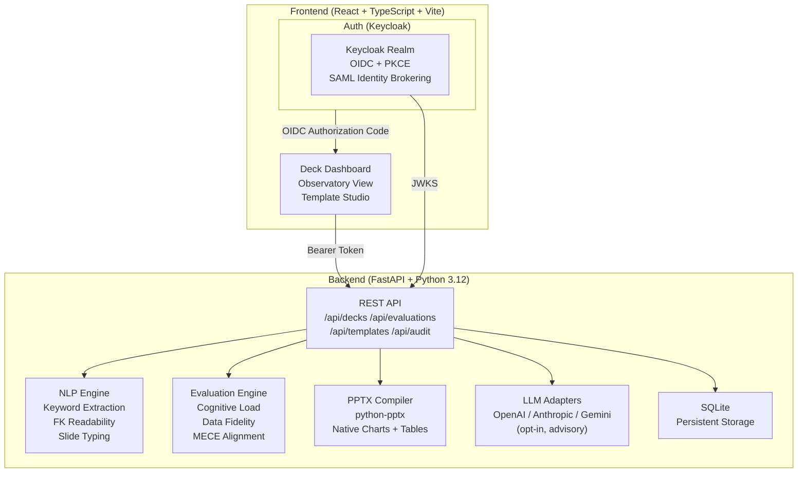

# Sentinel Observatory | Alan Vo | AI & Machine Learning

> Work in progress. This checkpoint may be incomplete or fail tests. See PLAN.md and STATUS.md before use.


Current version: `1.0.0`.

Sentinel Observatory turns documents or topics into native PowerPoint decks through deterministic AI/ML workflows — evaluating cognitive load, data grounding, and structural quality before compiling real `.pptx` files with native shapes, charts, and speaker notes.

**Problem:** Generating presentations with verifiable quality is hard. LLM-generated decks often contain unsupported numeric claims, excessive information density, and no structural coherence measure. Sentinel Observatory solves this by running a reproducible multi-factor evaluation pipeline on every deck before export.

**Implemented AI/ML approach:** A deterministic offline NLP engine (TF-IDF keyword extraction, Flesch-Kincaid readability, MECE structural alignment, heuristic slide-type classification) produces structured slide blueprints. A separate cognitive-load rubric scores information density, bullet brevity, hierarchy balance, and inter-slide topic overlap. An optional LLM layer adds advisory explanations, clearly labeled as non-authoritative.

**Intended users:** AI/ML engineers and researchers who need reproducible, quality-scored presentation generation — without black-box LLM dependency.

## Features

| Workflow | Description |
|---|---|
| **Topic → Deck** | Decompose any topic string into a structured slide outline with speaker notes, classified by slide type (title, KPI, chart, table, comparison, process) |
| **Document → Deck** | Convert freeform documents into presentation blueprints with section detection and per-slide keyword extraction |
| **Deck Observatory** | Score cognitive load across every slide — information density, bullet brevity, hierarchy balance, readability grade, MECE alignment |
| **Data Fidelity Audit** | Cross-validate numeric claims in slides against source data tables; reports precision, recall, and unsupported claims |
| **Attribution Guard** | Structural integrity check with actionable diagnostics (cross-platform, fail-closed, structured error codes ATTR-001 through ATTR-006) |
| **Prompt Budget Audit** | Token-budget and bilingual-key-drift audit; validates locale dictionary parity across languages |
| **Native PPTX Export** | Compile to real `.pptx` with native bar/line/pie charts, styled tables, slide transitions, and speaker notes via `python-pptx` |
| **Template Studio** | Register custom `.pptx` templates; scan master slides, placeholder layouts, and theme palettes |
| **Advisory LLM** | Opt-in explanations via OpenAI-compatible, Anthropic, or Gemini adapters; clearly labeled advisory, never fabricated |

## Architecture



## AI/ML Evaluation

The observatory evaluation is deterministic and runs offline — no LLM key required.

**Reproducible commands:**
```bash
cd /var/lib/alan-portfolio/workspaces/alan/sentinel-observatory-alan-vo
PYTHONPATH=backend .venv/bin/python -m pytest backend/tests/test_evaluations.py -v

# Standalone Attribution Guard integrity gate (#311):
PYTHONPATH=. .venv/bin/python -m backend.app.services.attribution_guard .
```

**Approach:** Multi-factor rubric with five independent metrics:

| Metric | Algorithm | Weight |
|---|---|---|
| Information Density | Char count + bullet count penalty (optimal: 30–150 chars, 3–5 bullets) | 25% |
| Bullet Brevity | Average words per bullet point (ideal ≤ 10 words → score 1.0) | 25% |
| Hierarchy Balance | Title-to-body word ratio (ideal 5–25%) | 15% |
| Readability Grade | Flesch-Kincaid grade level, normalized to 0–1 | 20% |
| MECE Alignment | Jaccard similarity between adjacent slide titles (low overlap = high MECE) | 15% |

**Data provenance:** All test inputs are generated inline in the test suite — no external datasets required.

**Baseline:** A well-structured 8-slide deck on a focused topic achieves an overall cognitive score ≥ 0.70. Decks with > 7 bullets per slide or > 600 chars body text score < 0.50.

**Failure cases and limitations:**
- MECE alignment is a lexical heuristic; semantically similar titles with different words score falsely high
- Flesch-Kincaid was calibrated on English prose; non-English decks produce inaccurate grade levels
- Data fidelity cross-validation requires numeric ground truth; purely qualitative source data yields 0% recall
- Advisory LLM explanations are opt-in and require a valid `LLM_API_KEY`; the deterministic core works without any key

## Install and Run

### Prerequisites

- Python 3.12
- Node.js 24
- Docker + Docker Compose (for full stack)

### Local Development

```bash
# Backend
python3 -m venv .venv
.venv/bin/pip install -r backend/requirements.txt
DEMO_MODE=true PYTHONPATH=backend .venv/bin/uvicorn backend.app.main:app --host 127.0.0.1 --port 8000

# Frontend (separate terminal)
cd frontend
npm install
npm run dev
```

> **Demo mode** (`DEMO_MODE=true`) binds localhost only and enables a pre-authenticated demo user. It refuses to start in `APP_ENV=production`.

### Full Stack (Docker Compose)

```bash
cp .env.example .env
# Edit .env with your OIDC / LLM configuration
docker compose up -d
```

Access the app at `http://127.0.0.1:5173`.

### Run Tests

```bash
# Backend
PYTHONPATH=backend .venv/bin/python -m pytest backend/tests -v

# Frontend
cd frontend && npm test

# Frontend build + typecheck
cd frontend && npm run build
```

## API Endpoint Reference

| Method | Path | Auth | Description |
|---|---|---|---|
| `GET` | `/api/health` | None | Health check |
| `GET` | `/api/auth/config` | None | OIDC configuration for PKCE flow |
| `GET` | `/api/auth/me` | Bearer | Current user info and roles |
| `GET` | `/api/decks` | Bearer (viewer) | List decks with pagination and filtering |
| `POST` | `/api/decks/generate/topic` | Bearer (operator) | Generate deck from topic |
| `POST` | `/api/decks/generate/document` | Bearer (operator) | Generate deck from document text |
| `GET` | `/api/decks/{id}` | Bearer (viewer) | Deck detail with all slides |
| `DELETE` | `/api/decks/{id}` | Bearer (operator) | Delete deck |
| `POST` | `/api/decks/{id}/slides` | Bearer (operator) | Add slide to deck |
| `PATCH` | `/api/decks/{id}/slides/{sid}` | Bearer (operator) | Update slide fields |
| `GET` | `/api/decks/{id}/export/pptx` | Bearer (viewer) | Download compiled `.pptx` |
| `POST` | `/api/evaluations/{id}/cognitive` | Bearer (viewer) | Cognitive load evaluation |
| `POST` | `/api/evaluations/{id}/fidelity` | Bearer (viewer) | Data fidelity audit |
| `POST` | `/api/evaluations/{id}/attribution` | Bearer (viewer) | Attribution guard check |
| `POST` | `/api/evaluations/{id}/prompt-audit` | Bearer (viewer) | Prompt budget and locale audit |
| `GET` | `/api/templates` | Bearer (viewer) | List slide templates |
| `GET` | `/api/audit/logs` | Bearer (admin) | Security audit log |

## Provider Configuration

| Variable | Required | Description |
|---|---|---|
| `LLM_API_KEY` | For LLM features | Your LLM provider API key (server-side only) |
| `LLM_PROVIDER` | No | `openai-compatible` (default), `anthropic`, or `gemini` |
| `LLM_MODEL` | No | Model identifier (default: `gpt-4o-mini`) |
| `LLM_BASE_URL` | No | Custom base URL for OpenAI-compatible providers (LiteLLM, Ollama, OpenRouter) |
| `OIDC_ISSUER_URL` | Yes (prod) | Keycloak realm URL |
| `OIDC_CLIENT_ID` | Yes (prod) | OIDC client identifier |
| `DEMO_MODE` | No | `true` for local development (refused in production) |

## SSO and SAML Setup

Sentinel Observatory uses Keycloak as its OIDC provider. Keycloak supports upstream SAML identity providers through identity brokering.

**Local Keycloak setup:**
```bash
docker compose up keycloak -d
# Import the realm: ./keycloak/realm-export.json is auto-imported on start
# Admin console: http://127.0.0.1:8080 (admin / admin_password_for_local_dev_only)
```

**SAML upstream IdP (enterprise):**
1. In Keycloak admin console → Identity Providers → Add provider → SAML v2.0
2. Configure your IdP metadata URL or upload the XML descriptor
3. Map SAML attributes to Keycloak roles (`viewer`, `operator`, `admin`)
4. Users authenticate through your IdP; Keycloak issues OIDC tokens to the app

**PKCE flow:** The frontend implements authorization code + PKCE. Tokens are kept in memory only — never persisted to `localStorage`. The PKCE `code_verifier` is stored in `sessionStorage` only during the redirect and cleared immediately after the token exchange.

## Security

- All data API endpoints require a valid Bearer token; unauthenticated requests return 401
- Demo mode refuses to start when `APP_ENV=production`
- Tokens are never logged; LLM errors are redacted before returning to clients
- TLS termination should be handled by a reverse proxy (nginx/Caddy) in front of the containers
- SQLite database file is stored in a named Docker volume; back up `backend_data` volume for disaster recovery

> **Security limitation:** This application has not undergone a formal security audit. Review and harden before production deployment.

## Backup and Restore

```bash
# Backup SQLite database
docker compose exec backend sqlite3 /app/data/sentinel.db .dump > backup.sql

# Restore
docker compose exec -T backend sqlite3 /app/data/sentinel.db < backup.sql
```

---

Alan Vo | alanvo@gmail.com
